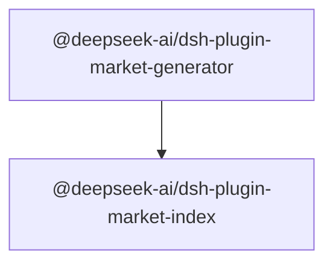

# Package relationships

English | [中文](package-relationships.zh.md)

This reference projects the current workspace manifests, not a second hand-maintained dependency policy. Nodes are real workspace packages; directed edges mean declared runtime dependencies. It does not infer runtime composition, dynamic registration or type-only imports. [Architecture](architecture.md) owns behavior and dependency direction; package READMEs own each contract.

## Workspace graph

<!-- BEGIN GENERATED package-relationships -->

<!-- END GENERATED package-relationships -->

## Updating the projection

`scripts/doc-graphs.manifest.json` owns graph roots, outputs and edge selection. After changing workspace membership or dependencies, regenerate with `pnpm run gen-doc-graphs` and check freshness with `pnpm run gen-doc-graphs --check`. Never fix a stale projection by hand-editing its generated region. Review the relationships against the source manifests as well as Mermaid syntax; freshness does not prove the architecture is appropriate. Both languages share the same generated content; review prose and record their pair separately.
